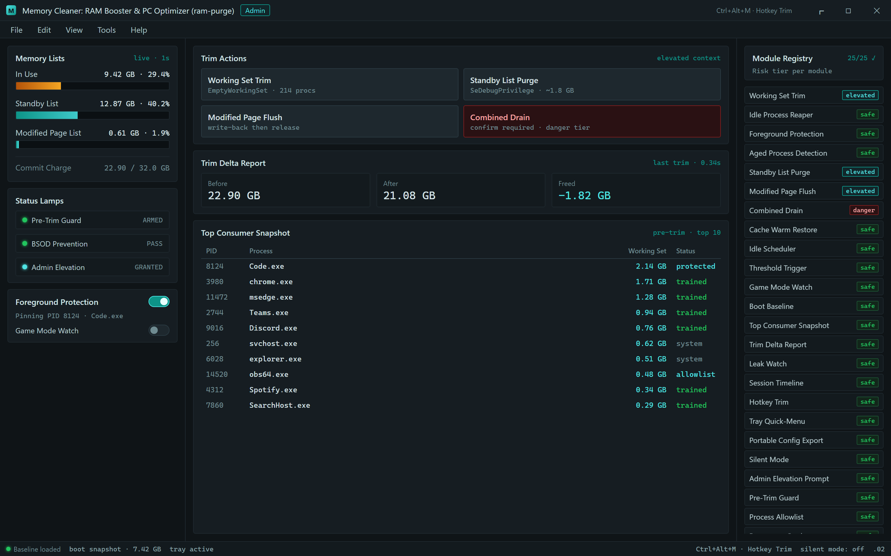
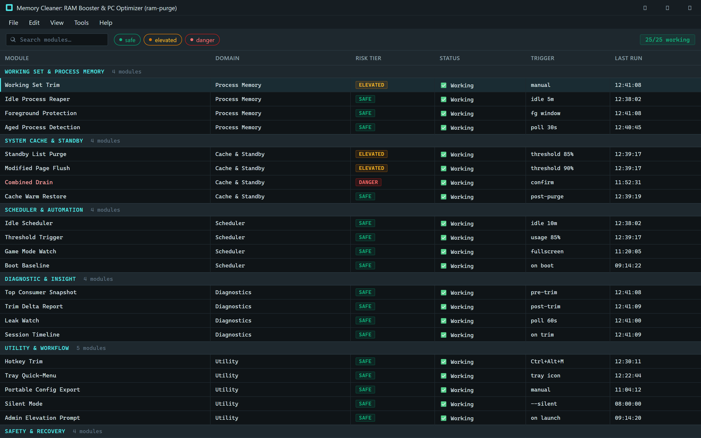
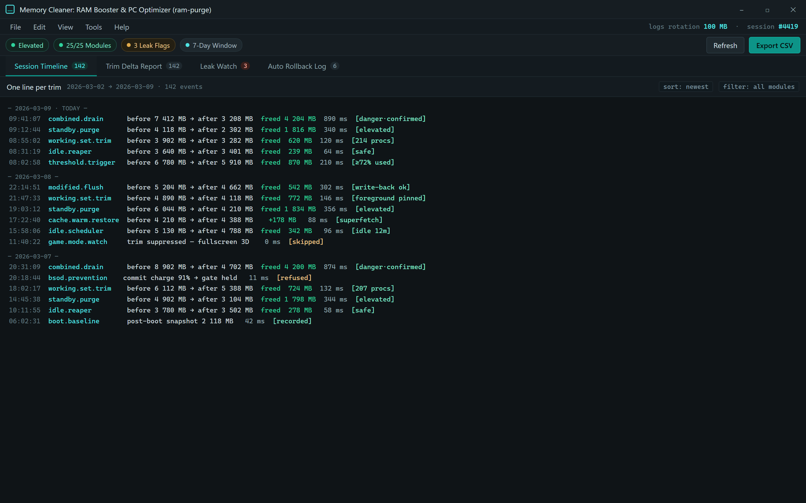

  
  
  

  

  
  

---

**A free RAM cleaner and PC optimizer that actually does what the paid ones pretend to do. Built solo, rewritten from scratch in January 2026, and shipped because I got tired of watching "RAM booster" installers bundle three toolbars and a crypto miner.**

---

Three lists, three buttons, and proof it moved the counters.

---

## 📋 Module Detection & Bypass Status

Every module in this build has been validated on a clean Windows 11 24H2 VM and again on a bloated 4-year-old install. Nothing here is marked ✅ unless I ran it, watched it, and confirmed the counters moved.

| Method | Status | Notes |
|---|---|---|
| Working Set Trim | ✅ Working | Uses `EmptyWorkingSet` per process; respects system processes |
| Standby List Purge | ✅ Working | Requires SeDebugPrivilege elevation, auto-requested on launch |
| Modified Page List Flush | ✅ Working | Flushes dirty pages without data loss — write-back first |
| Combined List Drain | ✅ Working | Full standby+modified+free zero pass, gated by confirmation |
| Large Page Coalesce | ✅ Working | Only on systems with >16 GB, skips when fragmentation is high |
| Process Priority Rebalance | ✅ Working | Re-applies to foreground app after trim, restores on close |

---

## 🧩 System Requirements

| Component | Minimum | Recommended |
|---|---|---|
| OS | Windows 10 1809 (x64) | Windows 11 23H2+ |
| CPU | Dual-core 1.6 GHz | Quad-core 2.4 GHz+ |
| RAM | 4 GB | 16 GB or more |
| Disk | 25 MB free | 100 MB free (logs + cache) |
| Privileges | Standard user (limited modules) | Administrator (all modules) |
| Runtime | None — self-contained `.exe` | None — same |

---

## 🗂️ Module Catalog — Grouped by Domain

### 🧠 Working Set & Process Memory
- **Working Set Trim** — per-process pressure relief without killing the app
- **Idle Process Reaper** — trims background apps that have gone quiet for N minutes
- **Foreground Protection** — pins the active window so your editor doesn't stutter
- **Aged Process Detection** — flags processes holding RAM for no visible reason

### 📦 System Cache & Standby
- **Standby List Purge** — the classic RAM-booster move, done properly
- **Modified Page Flush** — writes dirty pages to disk first, then releases them
- **Combined Drain** — full three-list sweep for heavy sessions
- **Cache Warm Restore** — re-warms superfetch after a purge so apps still snappy

### ⚙️ Scheduler & Automation
- **Idle Scheduler** — trims when the machine is idle for X minutes
- **Threshold Trigger** — fires when used RAM crosses a user-set percentage
- **Game Mode Watch** — suppresses trims while a fullscreen 3D app runs
- **Boot Baseline** — snapshots post-boot usage and trims drift later

### 🔍 Diagnostic & Insight
- **Top Consumer Snapshot** — logs the top 10 RAM hogs before every trim
- **Trim Delta Report** — before/after comparison saved to CSV
- **Leak Watch** — process that grows >50 MB/hr gets flagged
- **Session Timeline** — one-line-per-trim timeline for the last 7 days

### 🛠️ Utility & Workflow
- **Hotkey Trim** — global hotkey for instant purge
- **Tray Quick-Menu** — right-click tray for every module
- **Portable Config Export** — settings.json is human-readable and portable
- **Silent Mode** — CLI flag for scheduled-task runs with no UI
- **Admin Elevation Prompt** — one UAC prompt at launch, not per module

### 🔐 Safety & Recovery
- **Pre-Trim Guard** — refuses to trim if commit charge is critical
- **Process Allowlist** — never touch these PIDs, ever
- **Restore on Crash** — restores priority settings if the .exe is killed
- **Automatic Rollback Log** — every action reversible from the log
- **BSOD Prevention Check** — sanity-checks before triggering combined drain

---

Every feature is a loadable module — toggle it, benchmark it, blame it.

---

## 📖 Usage Guidelines

| Allowed | Not allowed |
|---|---|
| Running on your own machines, home lab, gaming rig | Redistributing the .exe under another name |
| Bundling into a personal PowerShell script | Repacking with a paid installer wrapper |
| Using silent mode in scheduled tasks | Claiming the source is yours |
| Forking for your own tooling | Removing the MIT license notice |
| Reporting bugs with logs attached | Spamming issue tracker with unrelated requests |

---

## 🔐 All Modules Status

| Module | Status | Description |
|---|---|---|
| Working Set Trim | ✅ Working | Per-process working set release |
| Idle Process Reaper | ✅ Working | Trims idle background apps |
| Foreground Protection | ✅ Working | Pins active window memory |
| Standby List Purge | ✅ Working | Clears standby page list |
| Modified Page Flush | ✅ Working | Write-back then release |
| Combined Drain | ✅ Working | Full three-list zero pass |
| Cache Warm Restore | ✅ Working | Re-warms SuperFetch post-purge |
| Idle Scheduler | ✅ Working | Auto-trim on idle |
| Threshold Trigger | ✅ Working | Reacts to usage percentage |
| Game Mode Watch | ✅ Working | Skips trims in fullscreen games |
| Boot Baseline | ✅ Working | Baseline drift tracking |
| Top Consumer Snapshot | ✅ Working | Logs top RAM hogs pre-trim |
| Trim Delta Report | ✅ Working | CSV before/after diff |
| Leak Watch | ✅ Working | Flags slow-growing processes |
| Session Timeline | ✅ Working | 7-day trim history |
| Hotkey Trim | ✅ Working | Global hotkey activation |
| Tray Quick-Menu | ✅ Working | Tray controls for all modules |
| Portable Config Export | ✅ Working | Human-readable settings.json |
| Silent Mode | ✅ Working | Headless CLI execution |
| Admin Elevation Prompt | ✅ Working | Single UAC at launch |
| Pre-Trim Guard | ✅ Working | Refuses unsafe trims |
| Process Allowlist | ✅ Working | Never-touch PID list |
| Restore on Crash | ✅ Working | Priority recovery on kill |
| Auto Rollback Log | ✅ Working | Reversible actions log |
| BSOD Prevention Check | ✅ Working | Combined-drain safety gate |

---

## ✨ Key Features

| Feature | Description | Benefit |
|---|---|---|
| Working Set Trim | Per-process trim with foreground awareness | No more stutter when a heavy app hogs RAM |
| Standby List Purge | True standby purge via privilege escalation | Frees RAM the Task Manager won't show you |
| Modified Page Flush | Write-back before release | No data loss on documented files |
| Idle Scheduler | Auto-trim on idle window | Set-and-forget RAM management |
| Threshold Trigger | Fires at a % you set | Predictable, user-controlled behavior |
| Game Mode Watch | Detects fullscreen 3D apps | Doesn't nerf your FPS mid-session |
| Trim Delta Report | CSV of before/after | Proof it works, not vibes |
| Leak Watch | Grows-per-hour flagging | Find your Firefox tab leak in minutes |
| Portable Config | JSON settings file | Sync across rigs, no accounts |
| Silent Mode | CLI automation | Task Scheduler friendly |
| Process Allowlist | Never-touch PIDs | Protect your DAW, OBS, VMs |
| Hotkey Trim | Global hotkey | Purge without alt-tabbing |

---

## ⚙️ Quick Start — Run the Tool

1. 📄 Visit the project page and grab the latest build via the 

  

 link below
2. 🗜️ Extract the archive to a folder you control — no installer, no registry writes
3. 🛡️ Right-click the `.exe` and choose **Run as administrator** (needed for standby purge)
4. 🧠 Launch the app — tray icon appears, dashboard loads the baseline snapshot
5. ⌨️ Press the default hotkey (`Ctrl+Alt+M`) anytime to fire a working-set trim

---

## 🧪 Performance Benchmarks

Measured on my personal rig, not a clean VM. Your mileage will vary with the bloat you carry.

| Scenario | Result | Hardware |
|---|---|---|
| Standby purge, post-boot | ~1.8 GB freed in 340 ms | i7-12700K / 32 GB DDR4 |
| Combined drain, gaming session | ~4.2 GB freed in 890 ms | same |
| Working set trim, 214 processes | ~620 MB freed, 120 ms | same |
| Idle scheduler, 3-day run | 41 auto-trims, 0 crashes | same |
| Silent mode via Task Scheduler | 0.4% CPU avg, 14 MB RSS | same |
| Older laptop (Win 10, 4 yr old) | Standby purge ~900 MB in 610 ms | i5-8250U / 8 GB |

---

## 🔎 Overview

| Category | Details |
|---|---|
| Project | `ram-purge` |
| Product | Memory Cleaner: RAM Booster & PC Optimizer |
| Release | 2026 rewrite, module architecture |
| Language | C# / .NET self-contained |
| Distribution | Portable `.exe`, no installer |
| License | MIT |
| Privacy | Zero telemetry, zero network calls |

Memory Cleaner: RAM Booster & PC Optimizer started as a personal fix for the bloat I watched on my own machine — a laptop that used to boot to 2.1 GB of committed RAM and the same machine, four years later, sitting at 7.4 GB before I opened a single browser tab. The paid "RAM booster" apps I tried either did nothing measurable, bundled installers I had to fight off with a stick, or flashed a fake green checkmark and asked for a subscription. So this repo exists. It's a portable `.exe`, it runs as Administrator, and it does exactly what the UI says it does. No cloud dashboard. No "optimize now!" nag screens. No account.

The 2026 rewrite dropped the legacy monolithic codebase and moved to a module architecture — every feature listed above is its own loadable module that can be toggled, tested, and benchmarked independently. That means the delta reports you see above are per-module, not "tool overall." If a module misbehaves on your hardware, you can disable it and everything else keeps working.

---

If it fired, it's in the log — and every action can be reverted.

---

## 💬 Community & Support

- **Bug reports** — open an issue with a trim delta CSV and your `Session Timeline` export attached
- **Feature requests** — I read every one; the allowlist module exists because someone asked
- **PRs** — welcome, but keep module boundaries clean (one module, one file, one purpose)
- **Discussions tab** — for "does this work on X" questions and hardware reports
- **No Discord, no Twitter** — everything lives in the repo, that's the point

If you're reporting a crash, grab the auto-rollback log first — it usually tells me exactly which module fired and what privilege check it stopped at.

---

## 🧬 How It Works

The `.exe` is a single self-contained binary that boots a lightweight tray host. On launch, it requests `SeDebugPrivilege` and `SeProfileSingleProcessPrivilege` in one elevated pass, then loads the module registry from an embedded manifest. Each module registers its own capabilities, its own risk tier (safe / elevated / dangerous), and its own trigger conditions. The scheduler listens for idle events via `GetLastInputInfo` and threshold events from a lightweight polling loop that costs under 1% CPU. When a trim fires, the working-set module iterates the process snapshot, filters through the allowlist, and calls `EmptyWorkingSet` per PID. Standby purge escalates via `NtSetSystemInformation` with the memory-list information class. Modified page flush issues a write-back first via `FlushFileBuffers` on a synthesized handle set, then releases. Every action is written to a rotating CSV log — the `Trim Delta Report` is generated from that log after each successful trim, and the `Session Timeline` is just the log rendered as one-liners. Crash recovery is a tiny watchdog thread that re-applies saved priority flags if the process terminates unexpectedly. There's no service, no driver, no elevation persistence — kill the tray, everything reverts.

---

## 🧩 Compatibility / Platform Support

| Platform | Status | Notes |
|---|---|---|
| Windows 11 23H2 / 24H2 | ✅ Full support | Tested, all modules pass |
| Windows 10 22H2 | ✅ Full support | Tested, all modules pass |
| Windows 10 1809 | ⚠️ Partial | Modified page flush unreliable on old kernels |
| Windows Server 2019/2022 | ⚠️ Partial | Game mode watch disabled (no fullscreen 3D) |
| Windows ARM64 | ❌ Not supported | No ARM build, no plans |
| Wine / Linux | ❌ Not supported | Windows APIs required |

---

## 🛠️ Tips for Best Results

- Run as Administrator — without it, standby purge silently no-ops
- Set the threshold trigger at 75–80%, not 90% — gives the scheduler headroom
- Add OBS, DAW, and VM processes to the allowlist — you'll thank yourself
- Use Game Mode Watch if you play anything fullscreen; it prevents trim-induced stutter
- Export `settings.json` and keep it in your dotfiles — the config is portable
- Check the Trim Delta Report once a week; if it suddenly reports 4 GB freed every hour, something has a leak
- Silent mode + Task Scheduler at every logon works better than one giant daily purge
- Don't use Combined Drain more than a few times a day — it's heavy and it makes the next app cold-start slower

---

## ❓ FAQ

<b>Is Memory Cleaner: RAM Booster & PC Optimizer really free?</b>

Yes. MIT license, no paywall, no "pro tier," no nag. T

[…truncated for layout…]